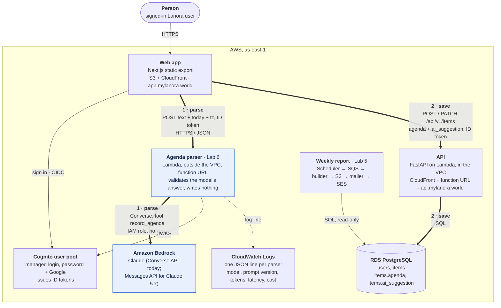

# Lanora — containers (C4, level 2)

Every box is something that runs or stores data; every arrow is a call, with the protocol on it.
Lab 6 added the agenda parser and Amazon Bedrock, and two paths that must not be confused:
**parse** (browser → parser → Bedrock), which only suggests, and **save** (browser → API → RDS),
which is the only one that writes. The decision is recorded in
[ADR 0006](adr/0006-llm-agenda-parsing.md).

| Container | Runs | Talks to | Why it is where it is |
|---|---|---|---|
| Web app | S3 + CloudFront | Cognito, API, parser | static files, no server |
| API | Lambda in the VPC | RDS | the only writer; validates every agenda it saves |
| Agenda parser | Lambda outside the VPC | Bedrock, Cognito JWKS | needs the internet, never the database: no NAT, no endpoint, $0 when idle |
| Amazon Bedrock | AWS-managed | — | Claude behind IAM; the bill is the AWS bill |
| RDS PostgreSQL | `db.t4g.micro` | — | the agenda and the parser's suggestion side by side in `items` |
